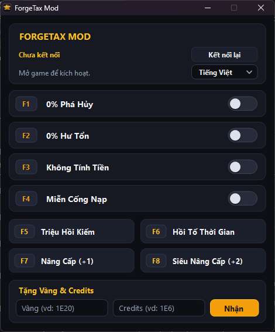
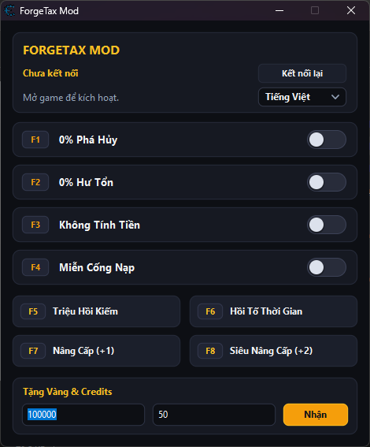

[English](README.md) | **Tiếng Việt**

# ForgeTax Mod

Công cụ mod gọn nhẹ cho **ForgeTax**, gồm ứng dụng độc lập (`ForgeTaxMod.exe`) và bảng **Cheat Engine** (`ForgeTaxMod.ct`), hỗ trợ phím tắt `F1`-`F8`, giao diện song ngữ và tự khôi phục trạng thái gốc khi thoát.

<p align="center">
  
  <br />
  <sub>Giao diện ứng dụng độc lập (<code>ForgeTaxMod.exe</code>)</sub>
</p>

## Tính Năng

| Phím tắt | Chức năng | Công dụng |
| :--- | :--- | :--- |
| **F1** | **0% Phá Hủy** | Vô hiệu hóa hoàn toàn tỉ lệ vỡ kiếm khi đập trên đe. |
| **F2** | **0% Hư Tổn** | Ngăn kiếm bị giảm cấp (`-1`) khi đập trượt. |
| **F3** | **Không Tính Tiền** | Thương nhân, máy chọn cổ vật và làm mới đều miễn phí `0` đồng. |
| **F4** | **Miễn Cống Nạp** | Rồng chấp nhận mọi thanh kiếm đặt lên bất kể giá trị, hoặc bấm chuông trống không bị tức giận. |
| **F5** | **Triệu Hồi Kiếm** | Triệu hồi ngay 1 thanh kiếm `+0` trước mặt không cần tải lại màn chơi. |
| **F6** | **Hồi Tố Thời Gian** | Kích hoạt đồng hồ hồi tố thanh kiếm vừa gãy lại trên đe với chi phí `0`. |
| **F7** | **Nâng Cấp (+1)** | Cộng `+1` cấp cho kiếm hiện tại; hỗ trợ nhấn giữ chuột hoặc phím để tăng liên tục. |
| **F8** | **Siêu Nâng Cấp (+2)** | Cộng `+2` cấp cho kiếm hiện tại; hỗ trợ nhấn giữ chuột hoặc phím để tăng liên tục. |

### Tặng Vàng & Credits
- Hỗ trợ nhập số thường (`100000`), dấu phân cách (`100.000`, `1,000,000`) và ký hiệu khoa học `E` (`1E6`, `1E20`).
- Thanh thông số hiển thị dấu chấm dưới `1.000.000` (`100.000`) và chuyển sang dạng `E` từ `1.000.000` trở lên (`1E6`, `1E20`).
- `Credits` được giới hạn an toàn trong khoảng `0`-`2.000.000.000` để tránh tràn số nguyên trong trò chơi.

## Cấu Trúc Thư Mục

```text
ForgeTaxMod/
|-- ForgeTaxMod.exe          # Ứng dụng C# x64 biên dịch sẵn
|-- ForgeTaxMod.ct           # Bảng Cheat Engine độc lập
|-- LICENSE                  # Giấy phép mã nguồn mở MIT
|-- README.md                # Tài liệu Tiếng Anh
|-- README-vi.md             # Tài liệu Tiếng Việt
|-- img/                     # Ảnh chụp giao diện
`-- source/                  # Mã nguồn C#
    |-- chuong_trinh.cs
    |-- dong_co_bo_nho.cs
    |-- dieu_khien_tuy_chinh.cs
    |-- giao_dien_chinh.cs
    |-- ngon_ngu.cs
    |-- yeu_cau_admin.manifest
    |-- bieu_tuong.ico
    `-- bien_dich.bat
```

## Hướng Dẫn Sử Dụng

### Cách 1 - Ứng Dụng Độc Lập (`ForgeTaxMod.exe`) *(Khuyên dùng)*
1. Chạy `ForgeTaxMod.exe` và xác nhận cấp quyền quản trị viên.
2. Mở **ForgeTax** rồi vào màn chơi.
3. Công cụ tự gắn vào trò chơi và mở khóa giao diện cùng phím tắt toàn cục `F1`-`F8`.
4. Dùng nút **Kết nối lại** và hộp chọn ngôn ngữ ở góc phải khung tiêu đề khi cần.

### Cách 2 - Bảng Cheat Engine (`ForgeTaxMod.ct`)
1. Mở `ForgeTaxMod.ct` bằng **Cheat Engine** và xác nhận cấp quyền quản trị viên.
2. Cửa sổ chính của **Cheat Engine** tự ẩn đi và chỉ hiển thị bảng điều khiển **ForgeTax Mod**.

<p align="center">
  
  <br />
  <sub>Giao diện bảng Cheat Engine (<code>ForgeTaxMod.ct</code>)</sub>
</p>

## Thông Tin Tương Thích

- **Hệ điều hành:** Windows 10 / 11 (x64), yêu cầu quyền quản trị viên.
- **Yêu cầu:** `.NET Framework 4.5+` cho `ForgeTaxMod.exe`; **Cheat Engine** `7.4+` cho `ForgeTaxMod.ct`.
- **Trò chơi:** **ForgeTax** (PC x64, `Unity IL2CPP` `GameAssembly.dll`); các bản cập nhật lớn có thể cần cập nhật lại chữ ký `AOB`.

## Miễn Trừ Trách Nhiệm

Dự án phát hành theo giấy phép [MIT](LICENSE) cho mục đích **giải trí cá nhân ở chế độ chơi đơn ngoại tuyến và nghiên cứu kỹ thuật**. Phần mềm được cung cấp nguyên trạng, không kèm bất kỳ bảo đảm nào; hãy sao lưu tệp lưu trước khi dùng vì giá trị quá lớn hoặc bản cập nhật mới có thể gây văng trò chơi.
