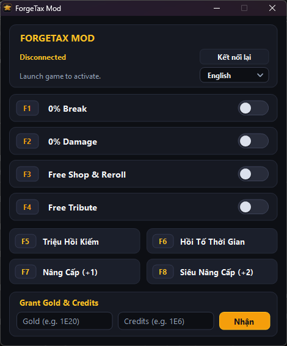
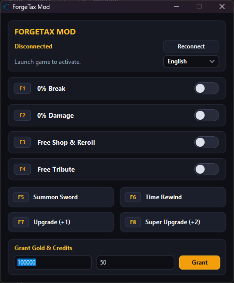

**English** | [Tiếng Việt](README-vi.md)

# ForgeTax Mod

Lightweight mod tool for **ForgeTax** with a standalone app (`ForgeTaxMod.exe`) and a **Cheat Engine** table (`ForgeTaxMod.ct`), supporting `F1`-`F8` hotkeys, bilingual UI, and automatic unhook on exit.

<p align="center">
  
  <br />
  <sub>Standalone App (<code>ForgeTaxMod.exe</code>)</sub>
</p>

## Features

| Hotkey | Control | Behavior |
| :--- | :--- | :--- |
| **F1** | **0% Break** | Prevents swords from breaking on the anvil. |
| **F2** | **0% Damage** | Prevents failed strikes from downgrading a sword (`-1`). |
| **F3** | **Free Shop & Reroll** | Makes Merchant purchases, Relic Vending Machine items, and Rerolls cost `0`. |
| **F4** | **Free Tribute** | Dragon accepts any placed sword regardless of value, or an empty bell ring without anger. |
| **F5** | **Summon Sword** | Spawns a `+0` sword immediately without reloading the run. |
| **F6** | **Time Rewind** | Triggers Time Rewind or restores the last broken sword onto the anvil at `0` cost. |
| **F7** | **Upgrade (+1)** | Upgrades the current sword by `+1`. Supports holding the button or key. |
| **F8** | **Super Upgrade (+2)** | Upgrades the current sword by `+2`. Supports holding the button or key. |

### Grant Gold & Credits
- Accepts plain integers (`100000`), grouped separators (`100.000`, `1,000,000`), and scientific notation (`1E6`, `1E20`).
- Status bar formats values below `1,000,000` with dots (`100.000`) and switches to `E` notation at `1,000,000+` (`1E6`, `1E20`).
- **Credits** are clamped to `0`-`2,000,000,000` to avoid 32-bit overflow.

## Package Structure

```text
ForgeTaxMod/
|-- ForgeTaxMod.exe          # Native x64 C# app
|-- ForgeTaxMod.ct           # Standalone Cheat Engine table
|-- LICENSE                  # MIT License
|-- README.md                # English documentation
|-- README-vi.md             # Vietnamese documentation
|-- img/                     # Interface screenshots
`-- source/                  # Full C# source code
    |-- chuong_trinh.cs
    |-- dong_co_bo_nho.cs
    |-- dieu_khien_tuy_chinh.cs
    |-- giao_dien_chinh.cs
    |-- ngon_ngu.cs
    |-- yeu_cau_admin.manifest
    |-- bieu_tuong.ico
    `-- bien_dich.bat
```

## Quick Start

### Option A - Native App (`ForgeTaxMod.exe`) *(Recommended)*
1. Launch `ForgeTaxMod.exe` and accept the **Administrator** prompt.
2. Start **ForgeTax** and enter a run.
3. The app attaches automatically and unlocks UI controls plus global `F1`-`F8` hotkeys.
4. Use **Reconnect** and the language dropdown on the right side of the header card whenever needed.

### Option B - Cheat Engine Table (`ForgeTaxMod.ct`)
1. Open `ForgeTaxMod.ct` with **Cheat Engine** and accept the **Administrator** prompt.
2. Cheat Engine hides its main window and opens the **ForgeTax Mod** panel.

<p align="center">
  
  <br />
  <sub>Cheat Engine Table (<code>ForgeTaxMod.ct</code>)</sub>
</p>

## Compatibility

- **OS:** Windows 10 / 11 (x64) with **Administrator** privileges.
- **Requirements:** Built-in .NET Framework 4.5+ for `ForgeTaxMod.exe`; **Cheat Engine** `7.4+` for `ForgeTaxMod.ct`.
- **Game:** **ForgeTax** (PC x64, Unity IL2CPP `GameAssembly.dll`); major game updates may require updating AOB signatures.

## Disclaimer

Released under the [MIT License](LICENSE) for **offline, single-player personal use and educational research**. Provided **"AS IS"** without warranty; back up your save files before use, as extreme values or unsupported game updates may cause crashes.
